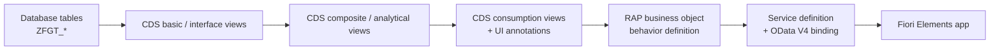

# SAP Purchase Analytics

Purchase analytics application built with the **ABAP Cloud** development model on **SAP BTP (ABAP Environment, trial)**.

This is a personal portfolio project. It covers the modern SAP stack end to end: data modeling in Eclipse ADT, a layered CDS view model, a RAP business object, and a Fiori Elements UI.

> **Status:** in progress. See the [roadmap](#roadmap) for what is done and what is next.

---

## Why this project

Most of my experience is in classic ABAP on ECC and S/4HANA: reports, enhancements, OData with SEGW, SAPUI5 and forms. I am building this project to work hands-on with the Clean Core / ABAP Cloud approach: released APIs only, CDS-based data models and RAP instead of SEGW.

## Architecture



## Roadmap

| Phase | Scope | Status |
|-------|-------|--------|
| A | Database tables and test data generator | ✅ Done |
| B | Layered CDS view model with annotations | 🔄 In progress |
| C | RAP business object (behavior definition and implementation) | ⏳ Planned |
| D | OData V4 service and Fiori Elements UI | ⏳ Planned |

## Data model

<!-- TODO: completar con las tablas reales del paquete -->

| Table | Description |
|-------|-------------|
| `ZFGT_...` | ... |
| `ZFGT_...` | ... |

## Tech stack

- SAP BTP ABAP Environment (trial)
- ABAP Cloud (ABAP for Cloud Development language version)
- Eclipse with ABAP Development Tools (ADT)
- Core Data Services (CDS)
- RESTful Application Programming Model (RAP), planned
- SAP Fiori Elements, OData V4, planned
- abapGit for version control

## Repository structure

The repository is linked through **abapGit** to the package `ZFGT_PURCH_ANALYTICS`. All custom objects use the `ZFGT_` prefix.

```
src/
├── tables/            # Database tables
├── data-generator/    # Test data generator class
└── cds/               # CDS views (Phase B)
```

<!-- TODO: ajustar a la estructura real que genera abapGit -->

## How to run it

1. Open a SAP BTP ABAP Environment (the trial works).
2. In Eclipse ADT, create the package `ZFGT_PURCH_ANALYTICS`.
3. Pull this repository into the package using abapGit.
4. Activate all objects.
5. Run the data generator class to populate the tables.
   <!-- TODO: nombre de la clase y cómo se ejecuta (p. ej. F9 si implementa IF_OO_ADT_CLASSRUN) -->

## Screenshots

<!-- TODO: agregar capturas (ADT, data preview de las CDS y, más adelante, la app Fiori) -->

## Author

**Felipe García T.** · SAP ABAP / Fiori Consultant
[LinkedIn](#) · [Portfolio](#)
