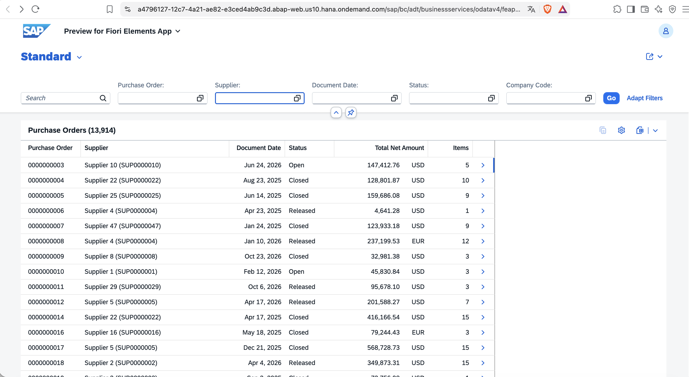
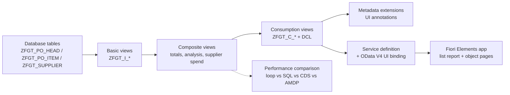
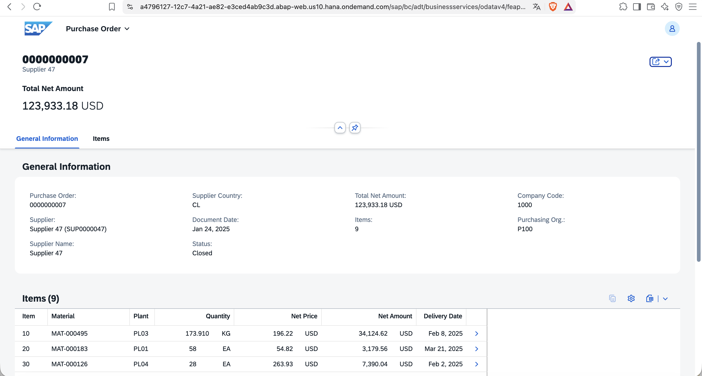
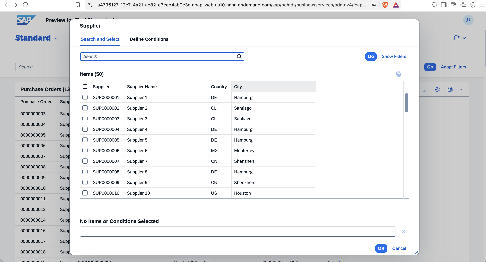
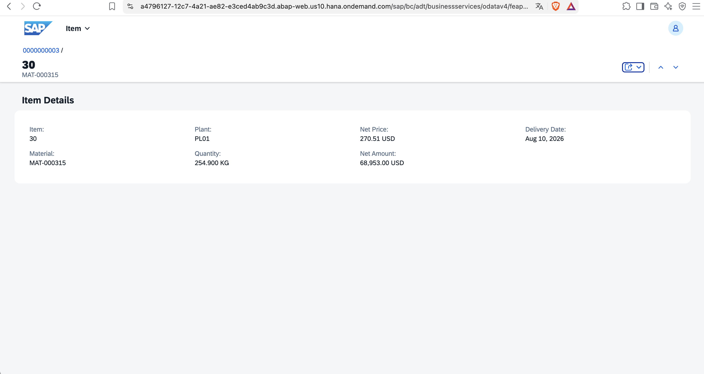
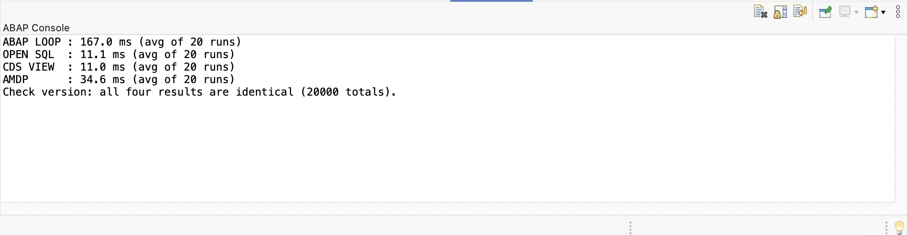
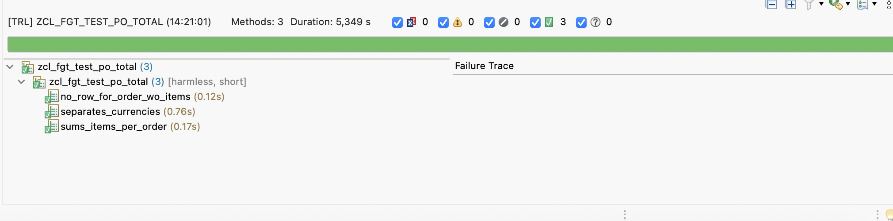
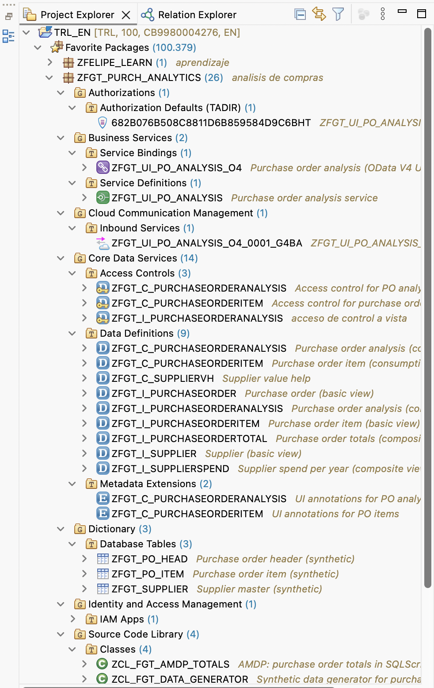

# SAP Purchase Analytics

Purchase analytics built with the **ABAP Cloud** development model on **SAP BTP (ABAP Environment, trial)**.

This is a personal portfolio project. It covers the modern SAP stack step by step: data modeling in Eclipse ADT, a layered CDS view model with access control, a measured comparison of code-pushdown techniques, unit tests with CDS test doubles, and an OData V4 service with a Fiori Elements app. A RAP business object comes next.

> **Status:** in progress. See the [roadmap](#roadmap) for what is done and what is next.

---

## Why this project

My background is in classic ABAP and SAP Fiori/UI5 on ECC and S/4HANA, mainly in AMS support: reports, enhancements, OData, SAPUI5 and forms. I am building this project to work hands-on with the Clean Core / ABAP Cloud approach: released APIs only, CDS-based data models, code pushdown to SAP HANA and RAP instead of SEGW.

## Architecture

## Roadmap

| Phase | Scope | Status |
|-------|-------|--------|
| A | Database tables and reproducible test data generator | ✅ Done |
| B | Layered CDS view model (basic and composite views, associations, aggregations, access control) | ✅ Done |
| C | Performance comparison (ABAP loop, Open SQL, CDS, AMDP) and ABAP Unit tests with CDS test doubles | ✅ Done |
| D | Consumption views, UI annotations, OData V4 service and Fiori Elements app | ✅ Done |
| E | RAP business object: create/update, validations, determinations, actions, draft and ETag | ⏳ Next |
| F | Web API for external consumption, ATC with ABAP Cloud checks, CI with abaplint, consuming an external REST API | ⏳ Planned |

## Data model

Synthetic purchasing data, loosely inspired by the standard EKKO/EKPO structure but not copied from it.

| Table | Description | Volume |
|-------|-------------|--------|
| `ZFGT_SUPPLIER` | Supplier master (name, country, city) | 50 |
| `ZFGT_PO_HEAD` | Purchase order header (supplier, company code, purchasing org, date, currency, status, admin fields for RAP) | 20,000 |
| `ZFGT_PO_ITEM` | Purchase order item (material, plant, quantity and unit, net price and amount, currency) | ~160,000 |

Design notes:

- **No stored totals in the header.** Order totals are calculated on read in CDS (code pushdown) instead of being stored redundantly.
- **RAP-ready admin fields** (`created_by`, `last_changed_at`, `local_last_changed_at`, …) are included from the start for later concurrency control (ETag).
- **Amounts and quantities** reference their currency and unit fields, as required for correct display and conversion.

### Test data generator

`ZCL_FGT_DATA_GENERATOR` fills the three tables with data that has a realistic shape:

- Pareto-like supplier concentration (a few suppliers account for most orders)
- Order status depending on age (older orders mostly closed)
- About 0.5% outlier items with very large quantities
- 80% USD / 20% EUR
- **Fixed random seed:** every run produces exactly the same data set, so results are reproducible

## CDS view model

| View | Layer | Purpose |
|------|-------|---------|
| `ZFGT_I_Supplier` | Basic | Supplier master with semantic field names |
| `ZFGT_I_PurchaseOrder` | Basic | Order header; associations to supplier and items |
| `ZFGT_I_PurchaseOrderItem` | Basic | Order items; amount/quantity semantics; association to header |
| `ZFGT_I_PurchaseOrderTotal` | Composite | Total net amount and number of items per order (`SUM`, `COUNT`, `GROUP BY`) |
| `ZFGT_I_PurchaseOrderAnalysis` | Composite | One row per order: header, supplier, year/month, status text and total |
| `ZFGT_I_SupplierSpend` | Composite | Spend and number of orders per supplier, year and currency |
| `ZFGT_C_PurchaseOrderAnalysis` | Consumption | Orders for the Fiori app; search, labels, value help, text arrangement |
| `ZFGT_C_PurchaseOrderItem` | Consumption | Items for the order's object page |
| `ZFGT_C_SupplierVH` | Consumption | Value help for the supplier filter |

All views are **CDS view entities** (`define view entity`), not the obsolete DDIC-based views.

**Access control (DCL):**

- `ZFGT_I_PurchaseOrderAnalysis` restricts rows by company code.
- `ZFGT_C_PurchaseOrderAnalysis` **inherits** those conditions (`inheriting conditions from entity`), so the rule lives in one place.
- `ZFGT_C_PurchaseOrderItem` restricts items through the association to their order (`_PurchaseOrder.CompanyCode`).

In this trial the condition is a fixed value to demonstrate the mechanism; in a real system it would use an authorization object, e.g. `aspect pfcg_auth( M_BEST_EKO, EKORG, ACTVT = '03' )`.

## Fiori Elements app

The service `ZFGT_UI_PO_ANALYSIS` exposes the consumption views through an **OData V4 UI binding**. The app is generated by Fiori Elements entirely from annotations, without custom UI code:

- **List report:** filter bar (`@UI.selectionField`), free-text search (`@Search`), columns (`@UI.lineItem`), supplier shown as name and code (`@ObjectModel.text.element` + `textArrangement`).
- **Value help** for the supplier filter (`@Consumption.valueHelpDefinition`).
- **Order object page:** title (`@UI.headerInfo`), total highlighted in the header (`@UI.dataPoint` + header facet), a general information section (`@UI.identification`) and an items table reached through the `_Item` association (`#LINEITEM_REFERENCE` facet).
- **Item object page:** item details reached from the items table.
- UI annotations live in **metadata extensions**, separate from the data model.
- The access control is enforced end to end: the app shows 13,914 of 20,000 orders (company code `1000` only).

## Performance comparison

`ZCL_FGT_PERF_COMPARISON` calculates the same result (total and item count per order over ~160,000 items) in four ways, measures each one and checks that all four results are identical.

| Variant | How it works | Median time |
|---------|--------------|-------------|
| ABAP loop | Fetch all items, aggregate on the application server (hashed table + `COLLECT`) | 162 ms |
| Open SQL | `SUM` / `GROUP BY` pushed down to HANA | 12 ms |
| CDS view | Reads `ZFGT_I_PurchaseOrderTotal` | 13 ms |
| AMDP | Same aggregation as a SQLScript database procedure (`ZCL_FGT_AMDP_TOTALS`) | 38 ms |

Median of 5 executions; each execution averages 20 measured runs per variant after one unmeasured warm-up run. All four variants returned the same 20,000 totals.

**Findings**

- **Code pushdown wins clearly.** Even with an optimized loop, aggregating in HANA (Open SQL or CDS) was about **13× faster** than aggregating in ABAP. The cost of the loop is mainly transferring every row to the application server.
- **Open SQL and CDS performed the same.** A CDS view does not make an equivalent query faster; its value is reusable, semantic logic that can be exposed to services and UIs.
- **AMDP was consistently ~25 ms slower** than Open SQL and CDS: the fixed cost of calling a database procedure. For logic that Open SQL or CDS can express, AMDP adds complexity without a performance benefit. It is the right tool only when the logic cannot be expressed there.
- **The internal table type matters.** The first version of the loop used `READ TABLE` + `INSERT` on a sorted table (median 323 ms). Switching to `COLLECT` on a hashed table halved the time with the same algorithm.

**How the measurement was validated**

- A first run showed Open SQL slower than CDS; reversing the execution order removed the difference (noise on a shared system).
- The first test harness copied the AMDP result into a different table type, a cost the other variants did not pay. A [controlled side-by-side run](https://github.com/felipegtrujillo/sap-purchase-analytics/commit/39eb81520cd09888e83ca0e8b55b4ad389136a5b) (original and corrected harness in the same commit, executed alternately) isolated it at about 5 ms; the remaining AMDP overhead is real.
- Timings come from a shared trial system and vary between runs. They show orders of magnitude, not exact benchmarks.

## Unit tests

`ZCL_FGT_TEST_PO_TOTAL` tests `ZFGT_I_PurchaseOrderTotal` with the **CDS Test Double Framework**: the view's data source is replaced by a test double filled with a few controlled rows, so the tests are deterministic and independent of the data in the system.

| Test | Rule it verifies |
|------|------------------|
| `sums_items_per_order` | Totals and item counts are aggregated per order |
| `no_row_for_order_wo_items` | No items produce no totals |
| `separates_currencies` | Amounts in different currencies are never summed together |

The test class declares its relation to the view (`"! @testing`), so the tests can be run directly from the CDS view.

## Screenshots

**Order object page:** header with highlighted total, general information and items.

**Supplier value help.**

**Item object page.**

**Performance comparison output.**

**ABAP Unit results.**

**Package structure in Eclipse ADT.**

## Known limitations

- **Currencies are not converted.** Spend per supplier is reported per currency, because summing USD and EUR would be meaningless and the trial has no exchange rates for `currency_conversion()`.
- **Access control uses a fixed condition** instead of authorization objects (no custom roles in the trial). As a consequence, the company code rule is written in two DCL roles (order analysis and items); with `pfcg_auth`, both would reference the same authorization object.
- **Shared trial system:** object names use the `ZFGT_` prefix to avoid collisions, and timings are noisy.

## Tech stack

- SAP BTP ABAP Environment (trial)
- ABAP Cloud (ABAP for Cloud Development language version)
- Eclipse with ABAP Development Tools (ADT)
- Core Data Services (CDS view entities, DCL, metadata extensions)
- AMDP (SQLScript)
- ABAP Unit with the CDS Test Double Framework
- OData V4 and SAP Fiori Elements
- abapGit for version control
- Planned: RESTful Application Programming Model (RAP)

## Repository structure

The repository is linked through **abapGit** to the package `ZFGT_PURCH_ANALYTICS` (folder logic `FULL`). abapGit serializes every object into `src/`:

| File pattern | Object type |
|--------------|-------------|
| `*.tabl.xml` | Database tables |
| `*.clas.abap` / `*.clas.xml` | Classes |
| `*.ddls.asddls` / `*.ddls.xml` | CDS view entities |
| `*.dcls.asdcls` / `*.dcls.xml` | CDS access control (DCL) |
| `*.ddlx.asddlxs` / `*.ddlx.xml` | Metadata extensions |
| `*.srvd.*` / `*.srvb.*` | Service definition and service binding |
| `package.devc.xml` | Package definition |

Screenshots for this README are in `docs/`.

## How to run it

1. Open a SAP BTP ABAP Environment (the trial works).
2. In Eclipse ADT, create the package `ZFGT_PURCH_ANALYTICS`.
3. Link this repository to the package with abapGit and pull.
4. Activate all objects.
5. Run `ZCL_FGT_DATA_GENERATOR` with **Run As → ABAP Application (Console)** (F9). It clears and refills the three tables.
6. Open the service binding `ZFGT_UI_PO_ANALYSIS_O4`, **publish** it, select the `PurchaseOrder` entity set and choose **Preview** to open the Fiori Elements app.
7. Optionally, run `ZCL_FGT_PERF_COMPARISON` the same way as the generator to reproduce the performance comparison, and `ZCL_FGT_TEST_PO_TOTAL` with **Run As → ABAP Unit Test**.

## Author

**Felipe García T.** · SAP ABAP / Fiori Consultant
<!-- TODO: add real links -->
[LinkedIn](#) · [Portfolio](#)
