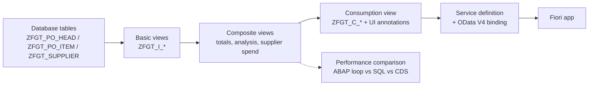

# SAP Purchase Analytics

Purchase analytics built with the **ABAP Cloud** development model on **SAP BTP (ABAP Environment, trial)**.

This is a personal portfolio project. It covers the modern SAP stack step by step: data modeling in Eclipse ADT, a layered CDS view model with access control, a measured comparison of code-pushdown techniques, and (next) an OData V4 service with a Fiori UI and a RAP business object.

> **Status:** in progress. See the [roadmap](#roadmap) for what is done and what is next.

---

## Why this project

My background is in classic ABAP and SAP Fiori/UI5 on ECC and S/4HANA, mainly in AMS support: reports, enhancements, OData, SAPUI5 and forms. I am building this project to work hands-on with the Clean Core / ABAP Cloud approach: released APIs only, CDS-based data models, code pushdown to SAP HANA and RAP instead of SEGW.

## Architecture

Solid boxes up to the composite layer are implemented; the consumption layer, service and app are planned (Phase D).

## Roadmap

| Phase | Scope | Status |
|-------|-------|--------|
| A | Database tables and reproducible test data generator | ✅ Done |
| B | Layered CDS view model (basic and composite views, associations, aggregations, access control) | ✅ Done |
| C | Performance comparison: ABAP loop vs Open SQL vs CDS (AMDP and ABAP Unit tests next) | 🔄 In progress |
| D | Consumption view, OData V4 service and Fiori UI | ⏳ Planned |
| E | RAP business object (behavior definition and implementation) | ⏳ Planned |

## Data model

Synthetic purchasing data, loosely inspired by the standard EKKO/EKPO structure but not copied from it.

| Table | Description | Volume |
|-------|-------------|--------|
| `ZFGT_SUPPLIER` | Supplier master (name, country, city) | 50 |
| `ZFGT_PO_HEAD` | Purchase order header (supplier, company code, purchasing org, date, currency, status, admin fields for RAP) | 20,000 |
| `ZFGT_PO_ITEM` | Purchase order item (material, plant, quantity and unit, net price and amount, currency) | ~160,000 |

Design notes:

- **No stored totals in the header.** Order totals are calculated on read in CDS (code pushdown) instead of being stored redundantly.
- **RAP-ready admin fields** (`created_by`, `last_changed_at`, `local_last_changed_at`, …) are included from the start for later concurrency control (ETag).
- **Amounts and quantities** reference their currency and unit fields, as required for correct display and conversion.

### Test data generator

`ZCL_FGT_DATA_GENERATOR` fills the three tables with data that has a realistic shape:

- Pareto-like supplier concentration (a few suppliers account for most orders)
- Order status depending on age (older orders mostly closed)
- About 0.5% outlier items with very large quantities
- 80% USD / 20% EUR
- **Fixed random seed:** every run produces exactly the same data set, so results are reproducible

## CDS view model

| View | Layer | Purpose |
|------|-------|---------|
| `ZFGT_I_Supplier` | Basic | Supplier master with semantic field names |
| `ZFGT_I_PurchaseOrder` | Basic | Order header; associations to supplier and items |
| `ZFGT_I_PurchaseOrderItem` | Basic | Order items; amount/quantity semantics; association to header |
| `ZFGT_I_PurchaseOrderTotal` | Composite | Total net amount and number of items per order (`SUM`, `COUNT`, `GROUP BY`) |
| `ZFGT_I_PurchaseOrderAnalysis` | Composite | One row per order: header, supplier, year/month, status text and total |
| `ZFGT_I_SupplierSpend` | Composite | Spend and number of orders per supplier, year and currency |

All views are **CDS view entities** (`define view entity`), not the obsolete DDIC-based views.

Access control: `ZFGT_I_PurchaseOrderAnalysis` is protected by a DCL role that restricts rows by company code. In this trial the condition is a fixed value to demonstrate the mechanism; in a real system it would use an authorization object, e.g. `aspect pfcg_auth( M_BEST_EKO, EKORG, ACTVT = '03' )`.

## Performance comparison

`ZCL_FGT_PERF_COMPARISON` calculates the same result (total and item count per order over ~160,000 items) in three ways, measures each one and checks that all results are identical.

| Variant | Run 1 | Run 2 (order reversed) |
|---------|-------|------------------------|
| ABAP loop (fetch all items, aggregate on the application server) | 319.7 ms | 330.1 ms |
| Open SQL (`SUM` / `GROUP BY` pushed down to HANA) | 26.1 ms | 16.3 ms |
| CDS view (`ZFGT_I_PurchaseOrderTotal`) | 17.0 ms | 17.2 ms |

Average of 5 runs per variant, after one unmeasured warm-up run. All three variants returned the same 20,000 totals.

**Findings**

- Pushing the aggregation down to HANA was **about 20× faster** than aggregating in an ABAP loop. The cost of the loop is mainly transferring every row to the application server.
- **Open SQL and CDS performed the same.** The 26.1 ms in run 1 was an outlier: reversing the execution order removed the difference. A CDS view does not make an equivalent query faster; its value is reusable, semantic logic that can be exposed to services and UIs.
- Timings come from a shared trial system and vary between runs. They show orders of magnitude, not exact benchmarks.

## Known limitations

- **Currencies are not converted.** Spend per supplier is reported per currency, because summing USD and EUR would be meaningless and the trial has no exchange rates for `currency_conversion()`.
- **Access control uses a fixed condition** instead of authorization objects (no custom roles in the trial).
- **Shared trial system:** object names use the `ZFGT_` prefix to avoid collisions, and timings are noisy.

## Tech stack

- SAP BTP ABAP Environment (trial)
- ABAP Cloud (ABAP for Cloud Development language version)
- Eclipse with ABAP Development Tools (ADT)
- Core Data Services (CDS view entities, DCL)
- abapGit for version control
- Planned: OData V4, SAP Fiori, RESTful Application Programming Model (RAP)

## Repository structure

The repository is linked through **abapGit** to the package `ZFGT_PURCH_ANALYTICS` (folder logic `FULL`). abapGit serializes every object into `src/`:

| File pattern | Object type |
|--------------|-------------|
| `*.tabl.xml` | Database tables |
| `*.clas.abap` / `*.clas.xml` | Classes |
| `*.ddls.asddls` / `*.ddls.xml` | CDS view entities |
| `*.dcls.asdcls` / `*.dcls.xml` | CDS access control (DCL) |
| `package.devc.xml` | Package definition |

## How to run it

1. Open a SAP BTP ABAP Environment (the trial works).
2. In Eclipse ADT, create the package `ZFGT_PURCH_ANALYTICS`.
3. Link this repository to the package with abapGit and pull.
4. Activate all objects.
5. Run `ZCL_FGT_DATA_GENERATOR` with **Run As → ABAP Application (Console)** (F9). It clears and refills the three tables.
6. Open the CDS views with **Data Preview**, or run `ZCL_FGT_PERF_COMPARISON` the same way to reproduce the performance comparison.

## Screenshots

<!-- TODO: ADT data preview of the CDS views, console output of the performance comparison, later the Fiori app -->

## Author

**Felipe García T.** · SAP ABAP / Fiori Consultant
<!-- TODO: add real links -->
[LinkedIn](#) · [Portfolio](#)
